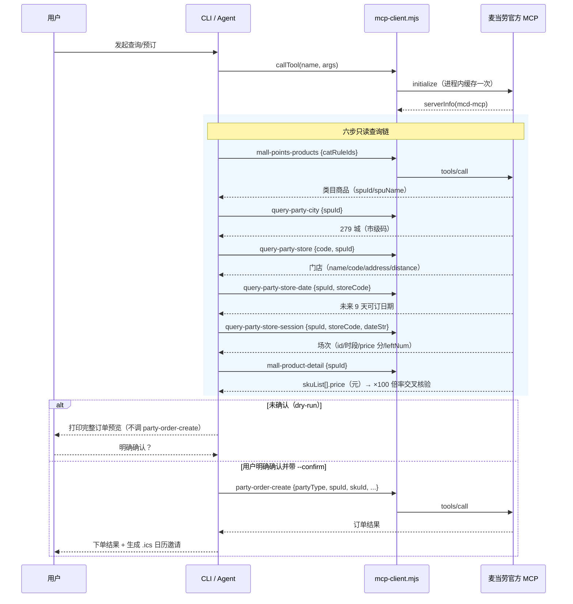

# MCP 集成说明（MCP_INTEGRATION.md）

本文档说明「麦麦派对管家 mcd-party-butler」如何集成麦当劳官方 MCP Server，
包括使用的工具、实测字段、调用时序与业务价值。文中字段名均以 2026-10-10
真机实测为准，**与官方工具描述文档不一致时，以本文实测结果为准**。

## 一、使用的 MCP Server

| 项目 | 说明 |
| --- | --- |
| Server 名称 | `mcd-mcp`（握手返回 `serverInfo.name = "mcd-mcp"`，version 1.0.0） |
| 端点 | `https://mcp.mcd.cn/mcp-servers/mcd-mcp` |
| 传输方式 | Streamable HTTP（普通 POST JSON-RPC 即可，无需 SSE 长连接；客户端仍兼容 `text/event-stream` 响应） |
| 鉴权 | 请求头 `Authorization: Bearer <token>`；token 来自环境变量 `MCD_MCP_TOKEN` 或文件 `~/.config/mcd/mcp_token` |
| 必要请求头 | `Accept: application/json, text/event-stream`、`Content-Type: application/json` |
| 握手 | `initialize`（protocolVersion `2024-11-05`），进程内缓存一次 |

## 二、用到的 7 个工具

### 1. `mall-points-products` — 派对类目商品列表

- 入参：`{ catRuleIds }`，派对类目树：`1>6>20` 生日类派对（6 商品）、`1>6>21` 主题类派对
  （13 商品）、`1>6>22` 麦麦体验营（当前为空）、`1>6>25` 品鉴会（6 商品）、
  `1>6>34` 读书会（1 商品）、`1>6>40` 积分兑换活动（当前为空）。
- 实测字段：`spuId, spuName, point, selling, upTime, downTime`。
- 注意：派对商品 point 显示 0 积分，**真实价格在场次层**（见工具 5）。

### 2. `query-party-city` — 可举办城市

- 入参：`{ spuId }`。
- 实测字段：`name, code, latitude, longitude, initial, sortNo`（实测 279 城）。
- **坑：`code` 是市级码（如上海市 310100），传省级码（310000）返回空数组。**

### 3. `query-party-store` — 可举办门店

- 入参：`{ code, spuId }`（code 为工具 2 返回的市级码）。
- 实测字段：`name, code, address, cityName, cityCode, latitude, longitude,
  distance(米), distanceText, businessStatus, onlineBusinessStatus`
  （上海过家家派对实测 174 家门店）。
- **坑：实测字段是 `name/code`，与工具描述文档中的 `storeName/storeCode` 不一致。**

### 4. `query-party-store-date` — 门店可订日期

- 入参：`{ spuId, storeCode }`。
- 实测返回：`[{ date: "2026-10-11", storeCode }]`，实测未来 9 天。

### 5. `query-party-store-session` — 场次列表

- 入参：`{ spuId, storeCode, dateStr: "YYYY-MM-DD" }`。
- 实测字段：`id, timeStart, timeEnd, partyMin, partyMax, price, leftNum` 等
  （实测样例：id 36925878，15:30-17:00，5-12 人，price 11800，leftNum 12）。
- **坑：`price` 单位是「分」**（11800 分 = ¥118）。

### 6. `mall-product-detail` — 商品详情（用于价格交叉核验）

- 入参：`{ spuId }`。
- 实测字段：`spuName, shopId(5), skuList[{skuId, price("118"，元字符串), points("0")}],
  selling, note(HTML 长文案), images[]`。
- 用途：与场次 `price`（分）交叉核验 ×100 倍率，核验通过才显示「¥118」，
  否则回退显示「单位待核实（原始 11800）」。

### 7. `now-time-info` — 服务器当前时间（连通性自检用）

- 入参：`{}`。用于三级自检验证连通性。

### 下单工具（只封装、严守安全门）

- `party-order-create`：入参实测为
  `{ partyType(1包场/2拼团), spuId, skuId, storeCode, dateStr, count,
  id(场次id), leftNum, code(城市码), timeStart, timeEnd, partyTimeInfo }`。
  本项目实现 dry-run 预览 + `--confirm` 才真正调用；测试全程严禁执行 confirm 路径。

## 三、完整调用时序

## 四、响应格式适配

`mcp-client.mjs` 的 `callTool(name, args)` 统一返回解析后的业务数据：

1. 优先取 `result.structuredContent.data`（mall-points-products、query-party-*、
   mall-product-detail 等均为此格式）；
2. 否则从 `result.content[0].text` 中截取 `## Original Response` 之后的字符串
   再 `JSON.parse`（如 list-nutrition-foods 等工具的包装格式）；
3. HTTP 非 200、JSON-RPC error、业务 `success=false`（如 code 600050）统一抛出
   可读中文错误；所有错误信息对 Authorization 值脱敏，绝不输出 token 明文。

## 五、业务价值：信息差消除

麦当劳派对的真实价格与剩余名额此前只能电话逐店询问，官方 App 入口深、比价成本高。
本工具把整条链路透明化：

- **场次价格透明**：场次（分）与商品详情（元）双源交叉核验，杜绝单位误读；
- **剩余名额透明**：`leftNum` 直接可见，`--available` 一键过滤有量场次；
- **比价/比店便利**：`--near` 按直线距离排序门店，跨店跨日比价只需两条命令；
- **成交闭环**：确认式下单 + .ics 日历邀请，把「发现活动」变成「订上场次」，
  与 mcd-event-radar（发现侧）形成互补闭环。
