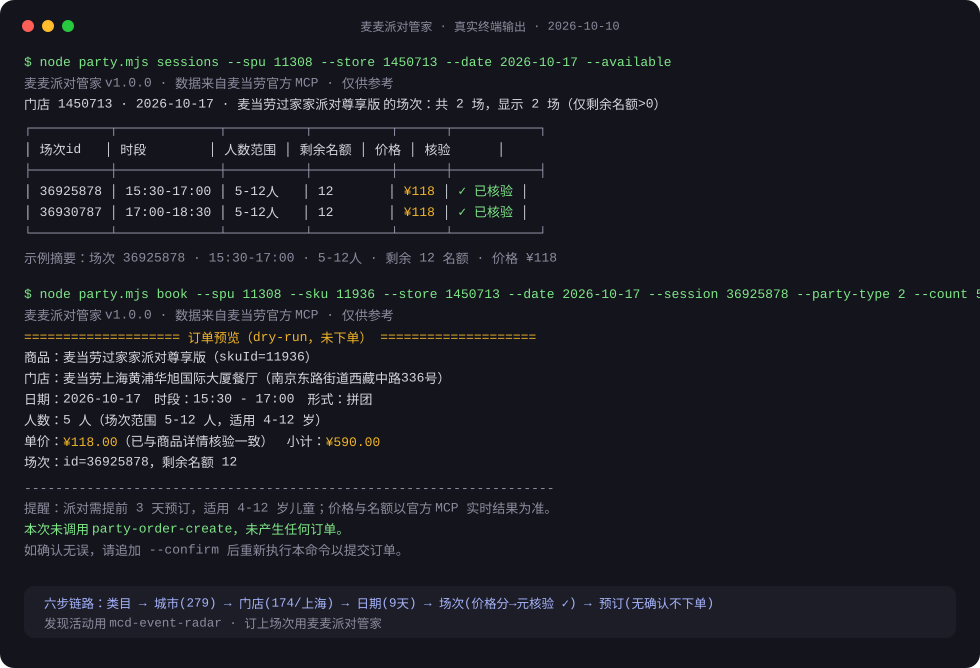
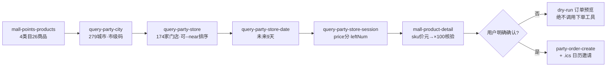

# 麦麦派对管家 mcd-party-butler

**发现活动用 mcd-event-radar，订上场次用麦麦派对管家。**

基于麦当劳官方 MCP 的派对预订闭环 Skill + 零依赖 Node CLI：类目 → 城市 → 门店 →
日期 → 场次五级查询，场次价格与商品详情双源交叉核验，剩余名额透明化，
确认式下单并生成 .ics 日历邀请。

`零依赖 · 只用 Node 内置模块` `Node ≥ 18` `麦当劳官方 MCP` `M-CODE 参赛作品` `MIT License`

[](https://github.com/xu9687/mcd-party-butler/actions/workflows/ci.yml)



```
$ node party.mjs sessions --spu 11308 --store 1450713 --date 2026-10-17 --available
麦麦派对管家 v1.0.0 · 数据来自麦当劳官方 MCP · 仅供参考
门店 1450713 · 2026-10-17 · 麦当劳过家家派对尊享版 的场次：共 2 场，显示 2 场（仅剩余名额>0）
┌──────────┬─────────────┬──────────┬──────────┬──────┬───────────┐
│ 场次id   │ 时段        │ 人数范围 │ 剩余名额 │ 价格 │ 核验      │
├──────────┼─────────────┼──────────┼──────────┼──────┼───────────┤
│ 36925878 │ 15:30-17:00 │ 5-12人   │ 12       │ ¥118 │ ✓ 已核验 │
│ 36930787 │ 17:00-18:30 │ 5-12人   │ 12       │ ¥118 │ ✓ 已核验 │
└──────────┴─────────────┴──────────┴──────────┴──────┴───────────┘

示例摘要：场次 36925878 · 15:30-17:00 · 5-12人 · 剩余 12 名额 · 价格 ¥118
```

（以上为真实 CLI 输出：价格由场次接口（分）与商品详情接口（元）交叉核验 ×100 倍率一致后标记「✓ 已核验」。）

## 一句话智能规划：`plan`

不想逐步查？一条命令把「类目→门店→日期→场次」全部串完，直接给你排序好的推荐表和可粘贴的下单命令：

```bash
$ node party.mjs plan --city 310100 --guests 6 --budget 150 --date 2026-10-17
```

```text
城市 310100 推荐场次（按价格升序 · 价格已与商品详情交叉核验）：
┌──────────────────┬───────────────┬────────────┬─────────────┬────────┬──────┬──────┬───────┐
│ 商品             │ 门店          │ 日期       │ 时段        │ 人数   │ 剩余 │ 单价 │ 距离  │
├──────────────────┼───────────────┼────────────┼─────────────┼────────┼──────┼──────┼───────┤
│ 麦当劳亲子读书会 │ 麦当劳上海黄… │ 2026-10-17 │ 10:30-12:00 │ 5-12人 │ 12   │ ¥45  │ 816m  │
│ 麦当劳亲子读书会 │ 麦当劳上海黄… │ 2026-10-17 │ 14:00-15:30 │ 5-12人 │ 12   │ ¥45  │ 816m  │
│ 麦当劳一起开心…  │ 麦当劳上海黄… │ 2026-10-17 │ 12:00-13:30 │ 5-12人 │ 12   │ ¥138 │ 415m  │
└──────────────────┴───────────────┴────────────┴─────────────┴────────┴──────┴──────┴───────┘

最划算方案（可直接粘贴执行，先预览再决定是否下单）：
  node party.mjs book --spu 1830 --sku 2106 --store 1450713 --date 2026-10-17 --session 36935759 --party-type 2 --count 6 --city 310100
```

（同样是真实输出：6 人、人均预算 ¥150 的条件下，读书会 ¥45/位被直接挖出来，比生日会便宜 3 倍。
`--json` 模式输出机器可读结果，供 Agent / 程序化调用；`--near "纬度,经度"` 可按你的位置排门店。）

## 和「只发现不预订」有什么不一样

| | 只发现（活动雷达类） | 麦麦派对管家 |
| --- | --- | --- |
| 场次价格 | 看不到，需电话逐店问 | 场次（分）× 商品详情（元）双源核验，直接显示 ¥118 |
| 剩余名额 | 不知道 | `leftNum` 直接可见，`--available` 一键过滤有量场次 |
| 门店比选 | 只给列表 | `--near` 按直线距离排序，跨店跨日比价两条命令 |
| 下单 | 做不到 | 确认式下单闭环 + 自动生成 .ics 日历邀请 |
| 定位 | 帮你发现活动 | 帮你把场次**订上**（与 mcd-event-radar 互补） |

## 30 秒上手

**路径 A · WorkBuddy 用户（推荐）**

```bash
node setup-connector.mjs   # 一键把 mcd-mcp 写入 WorkBuddy 连接器配置（自动备份、在线验证）
```

> 提示：若 WorkBuddy 侧报 mcd-mcp 连接错误，可尝试把 `~/.workbuddy/mcp.json`
> 中 `type` 改为全小写 `streamablehttp`（不同客户端对该字段的实现有差异）。

重开 WorkBuddy 会话后直接对话：

> 帮我看看上海周末有什么麦当劳派对

**路径 B · CLI 用户**

```bash
node party.mjs sessions --spu 11308 --store 1450713 --date 2026-10-17 --available
```

Token 获取：访问 https://open.mcd.cn/mcp 申请，设置环境变量 `MCD_MCP_TOKEN`
或写入 `~/.config/mcd/mcp_token`（Token 绝不写入任何仓库文件）。

## 六步调用链



## 安全承诺

- **无确认不下单**：`book` 不带 `--confirm` 只打印完整订单预览，绝不调用
  `party-order-create`；Agent 场景必须先向用户回显订单明细并获得明确确认。
- **token 不落仓库**：只从环境变量 `MCD_MCP_TOKEN` 或 `~/.config/mcd/mcp_token`
  读取；日志与错误信息统一脱敏，仓库内只有占位符示例。
- **数据以官方为准**：全部数据来自麦当劳官方 MCP 实时结果，本工具仅供参考。
- **非官方声明**：本项目为参赛者独立开发，非麦当劳官方产品。

## 文档

- [MCP 集成说明](MCP_INTEGRATION.md)：端点/鉴权/传输、7 个工具实测字段、调用时序图
- [Agent Skill 定义](SKILL.md)：三级自检、六步调用链、下单安全门、错误排查表
- [WorkBuddy 开发记录](workbuddy.md)：真实开发会话时间线
- [参赛声明](CONTEST_DECLARATION.md)：与官方仓库原文一致

## 参赛信息

本项目为「麦当劳程序员创意开发大赛（M-CODE）」参赛作品。
官方仓库：https://github.com/M-China/mcd-developer-innovation-challenge
